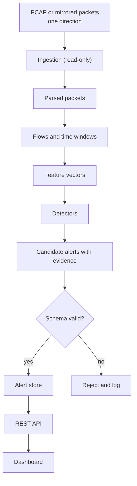

# Data Flow

| Stage | Input | Output | Failure handling |
|---|---|---|---|
| Ingest | pcap/interface | raw packets | skip corrupt, count |
| Parse | packets | flow records | malformed → counter |
| Features | flows | vectors | missing fields → `null` + availability mask |
| Detect | vectors | scored candidates | detector exceptions isolated |
| Normalise | candidates | alerts | schema failure logged |
| Store/API | alerts | JSON | 4xx/5xx per API doc |

No stage sends data toward the monitored network.
