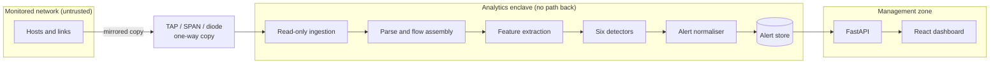

# System Architecture

> All components `PLANNED` until audited.

## Components
| Component | Responsibility | Trust zone |
|---|---|---|
| Ingestion | Read PCAP / mirror interface; no egress | Enclave |
| Parser / flow builder | Packets → flows/windows (observable direction only) | Enclave |
| Feature extractor | Per-detector features, streaming | Enclave |
| Detectors | Rule + ML scoring with evidence | Enclave |
| Normaliser | Validate against schema, deduplicate | Enclave |
| Alert store | SQLite/PostgreSQL (`UNVERIFIED` choice) | Enclave |
| API | Read-only query of alerts/metrics | Management |
| Dashboard | Display | Management |

Trust boundaries: Monitored network ⟶ (one-way) ⟶ Enclave ⟶ (read-only query) ⟶ Management. There is **no** component that transmits toward the monitored network.

More diagrams: [diagrams/README.md](diagrams/README.md). Decisions: [ARCHITECTURE_DECISIONS.md](ARCHITECTURE_DECISIONS.md).
