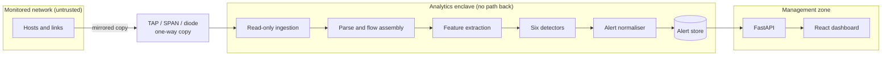
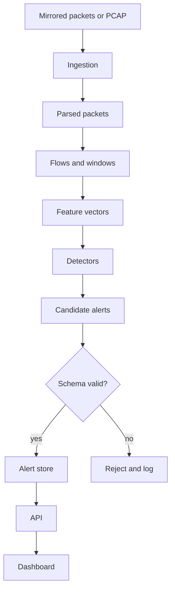
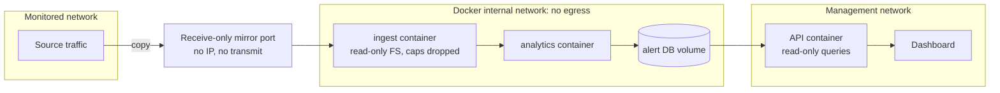
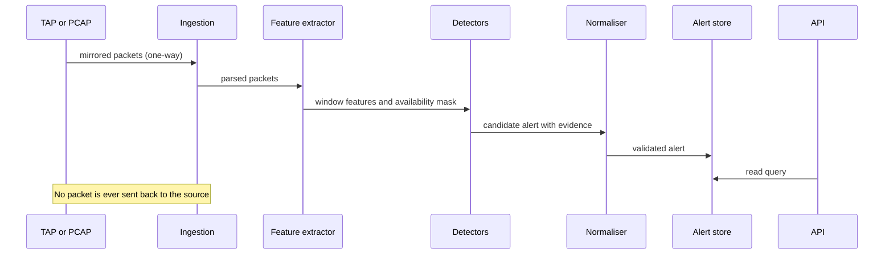
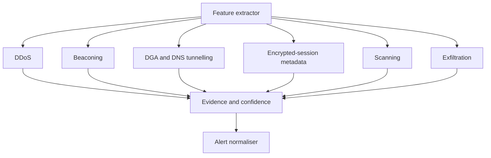
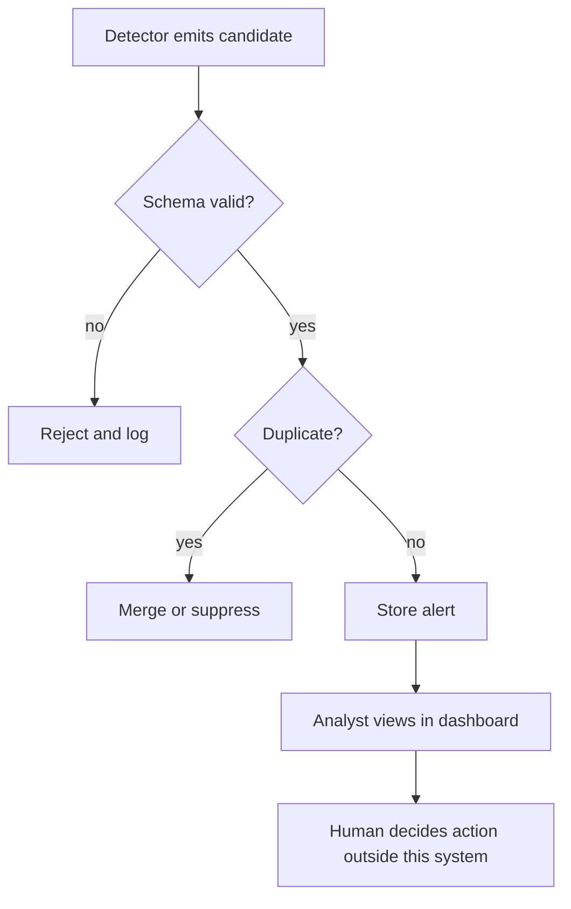
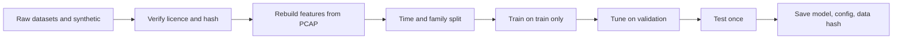
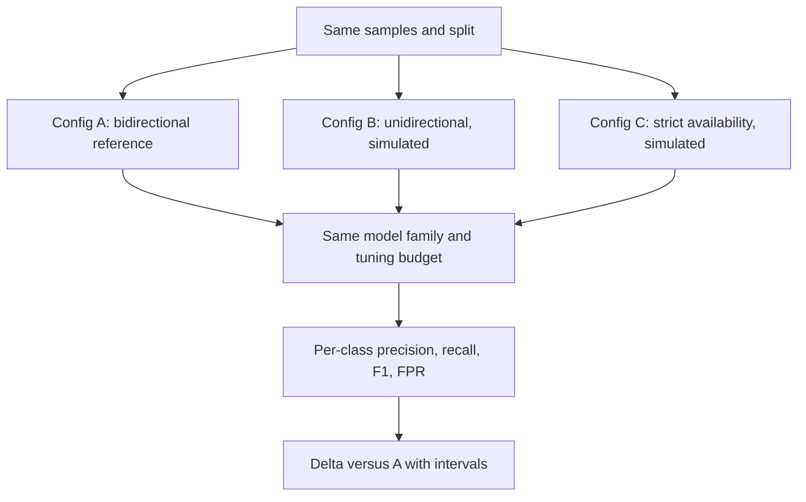
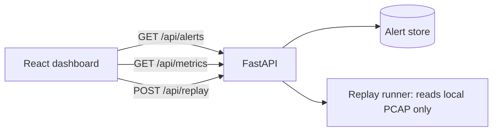
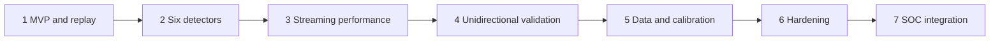

# Diagrams

All diagrams are **proposed designs**, not proof of implementation. No diagram shows a path from the enclave back to the monitored network.

## 1. High-level system architecture
Shows trust zones and the one-way copy. Slide: 4, 6.

## 2. Data flow
Shows each stage and the rejection path. Slide: 6.

## 3. Deployment and network isolation
Shows internal network and where the only bridge is. Slide: 6, 8.

## 4. Streaming detection sequence
Shows time order; note that nothing returns to the source. Slide: 6.

## 5. Six-detector components
Shows detectors share features and output. Slide: 7.

## 6. Alert lifecycle
Shows validation, dedup and human-only action. Slide: 8.

## 7. Dataset preparation and training pipeline
Slide: 9.

## 8. Experiment and directional-blindness flow
Slide: 8, 9, 10.

## 9. Frontend/backend integration
Slide: 11, 12.

## 10. Implementation roadmap
Slide: 13, 15.

